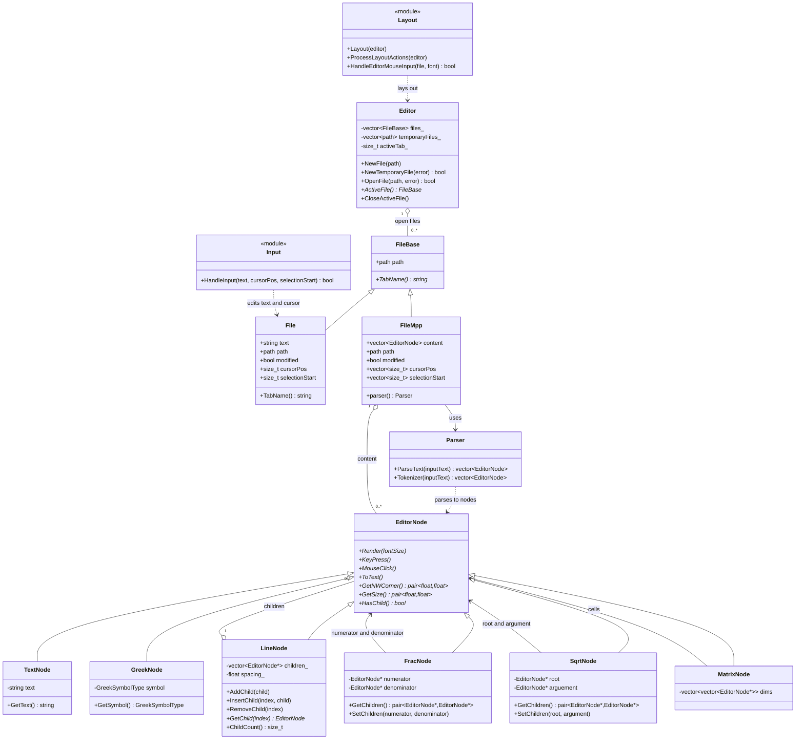

# Project UML

This class diagram shows the editor/runtime and math-node model, including the parser and `FileMpp` document path. Those two classes are not part of the current CMake executable target.

The math-node subclasses other than `LineNode` use private inheritance in the current C++ declarations. The diagram shows generalization while omitting that access detail.